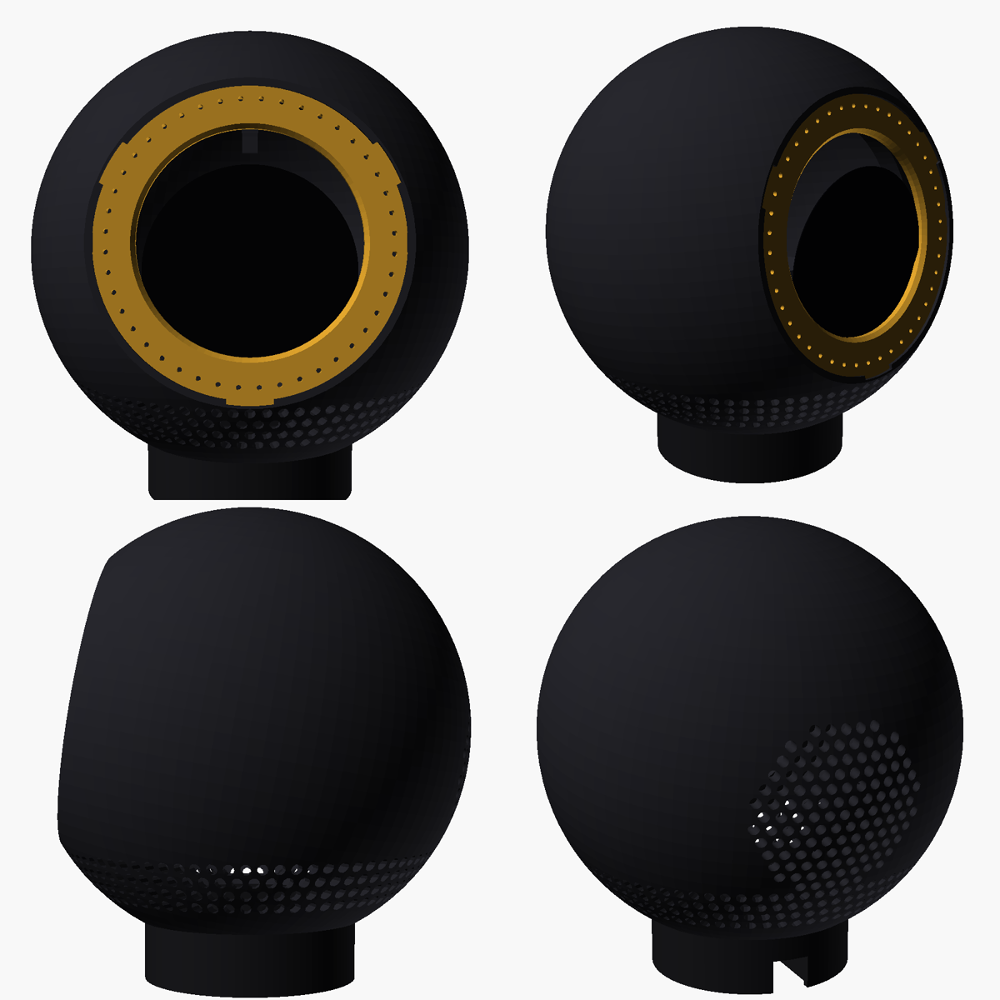

# Grok Bot Sphere

A desk voice assistant in a Grok Bot-style sphere: big blinking eyes on a 1.85" round screen, a wake word, and
Grok's realtime voice. It's built on a **Waveshare ESP32-S3-Touch-LCD-1.85C-BOX** in a 3D-printed ball. Out of the box
the assistant is called **Charlie**, a chief of staff.



> Unofficial fan project. Not affiliated with or endorsed by xAI. The look is inspired by @Texas_Twins_Dad's Grok Bot
> Sphere renders; the eyes are drawn from simple geometry.

## What it does

- **Talk:** say the wake word (or tap the screen), then speak. Charlie answers out loud through xAI realtime voice
  (`grok-voice-3.0`, pinned), using server-side turn detection.
- **Eyes:** blink, double-blink and wander when idle. They open wide while listening, squint while thinking, and pulse
  with the voice while speaking.
- **Interrupt:** tap while Charlie is talking and it stops at once (the paid session ends too).
- **Alarms:** "wake me at 6:30". Alarms are kept on the board across reboots. It chimes until you tap, then Charlie
  says good morning with the time and weather.
- **Watch faces:** swipe left or right to switch the eyes for a dive chronograph, a UH-1 Huey-style countdown timer
  ("set a timer for 12 minutes"), a Huey fuel-gauge-style "talk quantity" gauge (voice minutes left today) and a
  '67 big-block stinger-hood clock, and a Huey caution panel that sits dark until an alarm or timer lights it: tap MASTER CAUTION to reset.
  The dial art is baked by `tools/make_face_assets.py`; hands and digits are drawn live (`faces.cpp`).
- **Volume:** 10 levels, saved on the board. Swipe up or down on the screen, say "turn it down", or use the upper side
  button (BOOT) when the case is open.
- **Time and weather** for your home, from Open-Meteo (no key needed).
- **Optional Grok Bot hand-off:** bigger jobs (calendar, email, reminders) go to *your own* Grok Bot through a
  webhook routine. The answer comes back to the sphere, which chimes and reads it out. This is off until you add the
  secrets.
- **Small-speaker audio:** the codec runs at 48 kHz. The 24 kHz voice is upsampled 2x (windowed sinc), high-passed at
  150 Hz, given a +6 dB presence shelf at 2.8 kHz and a soft limiter, and played through a jitter buffer. The mic is
  decimated 3:1 to 16 kHz.

## Repository

| Folder | What |
|---|---|
| `firmware/grok_sphere` | Arduino-ESP32 3.3 sketch: LVGL eyes, audio path, relay client, alarms, wake word. Build notes in `README_BUILD.md`. |
| `relay` | Cloudflare Worker + Durable Object between the sphere and xAI. It holds the API key, paces audio, enforces a daily budget and handles the tools. |
| `case` | OpenSCAD enclosure (`grok_sphere.scad`) and print-ready STLs: one-piece body, twist-lock bezel, twist-lock base. See `case/README.md`. |
| `tools` | `sphere-wifi.sh` sets Wi-Fi over USB. `wake_speaker_test.py` is a peak-based wake-word speaker test. `render_*.py` + `make_face_assets.py` draw and bake the watch faces; `face_shots.py` captures them from the device. |

## Hardware

- Waveshare **ESP32-S3-Touch-LCD-1.85C-BOX** (puck D58 x 48.6 mm: ESP32-S3, 16 MB flash, 8 MB PSRAM, ES7210 mics,
  ES8311 + speaker, USB-C).
- A **right-angle USB-C cable**: the port is near the screen, inside the front collar.
- PLA for the case (about 72 g for the body at 0.20 mm), 1 mm foam, two 14 mm steel discs for weight, and a 46 mm felt
  pad.

## Setup

1. **Relay.** You need a Cloudflare account and an xAI API key.
   ```sh
   cd relay && npm install
   # edit wrangler.toml [vars]: HOME_LAT/HOME_LON, HOME_PLACE, OWNER_NAME, TIMEZONE, DAILY_MINUTES
   npx wrangler deploy
   npx wrangler secret put XAI_API_KEY      # paste at the hidden prompt
   npx wrangler secret put DEVICE_TOKENS    # a long random token for the sphere
   ```
2. **Firmware.** Follow `firmware/grok_sphere/README_BUILD.md`: `RELAY_URL=wss://<your relay>/ws ./make_secrets.sh`,
   build with arduino-cli, then flash.
3. **Wi-Fi:** `tools/sphere-wifi.sh`. It prompts for the network name and a hidden password and sends them over USB.
4. **Case:** print the body, bezel and base (see `case/README.md`). Assemble with the USB-C at 6 o'clock.

## Wake word

Without a custom model the sphere uses Espressif's stock **"Hi ESP"** (esp-sr WakeNet). For a custom word such as
"Hey Charlie", train a [microWakeWord](https://github.com/kahrendt/microWakeWord) streaming model and embed it with
`firmware/grok_sphere/make_wake_model.sh model.tflite "hey charlie" 0.80`. Train with sound-alike hard negatives, then
pick the cutoff from a **peak-based speaker test** (`tools/wake_speaker_test.py`), not from the offline ROC alone. No
model is included here: models trained on non-commercial datasets must not be redistributed.

## Cost

xAI bills voice per minute (about $0.08/min for grok-voice-3.0 at the time of writing). The relay only opens an xAI
session after a wake word or tap, closes it right after the answer (or after 8 s of silence, or 120 s), and stops
for the day at `DAILY_MINUTES` (default 30 min, about $2.40/day max). `GET /usage?token=…` shows minutes used.

## Credits

The Waveshare board drivers, the TFLite Micro audio frontend and KISS FFT are used under their licenses (see `NOTICE`).
The wake-word inference and the audio recipe are adapted from
[mosaico-grok-buddy](https://github.com/jaselton/mosaico-grok-buddy). Apache-2.0.
